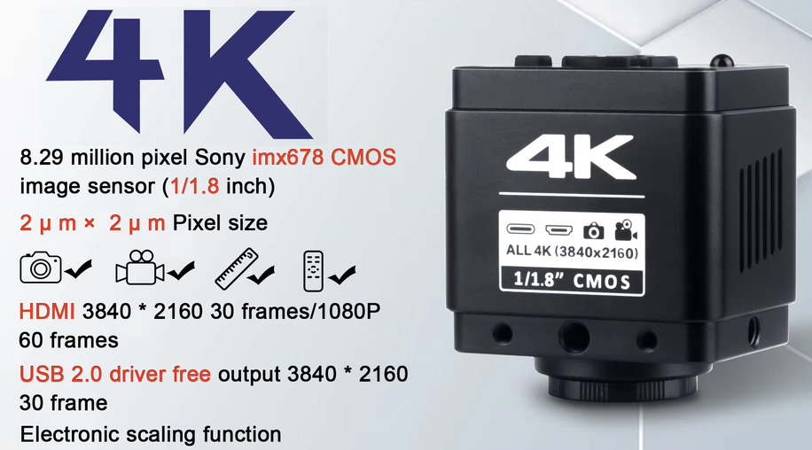
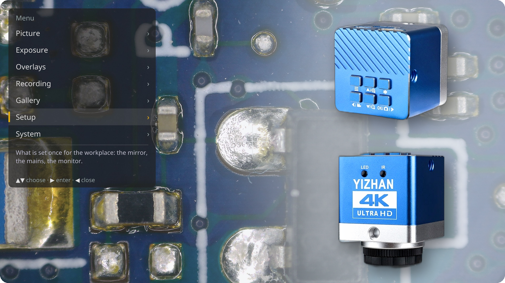

# OpenMicroCam for the IMX678 camera (black YIZHAN 4K): a fork

> **This is a fork of [OpenMicroCam](https://github.com/apnix/openmicrocam) by [apnix](https://github.com/apnix).**
> OpenMicroCam is their work: `microcamd`, the kernel modules, the build and the research into the SigmaStar platform.
> This fork only adds support for a second camera. Everything below the line is the original README, unchanged.



## What differs in this fork

This fork is for the **black YIZHAN 4K** microscope camera with a **Sony IMX678** sensor (1/1.8"), shown above. The
original project targets the XHU4012 with a GalaxyCore GC8613 sensor. Both cameras have the same board and SoC, but this
one has another sensor, another flash and another stock firmware:

- **A sensor driver for the IMX678** (`kmods/imx678`), with modes that fit the SoC's ISP. Over USB that gives **4K at 48**,
  **2560×1440 at 48** (full view), **1080p at 60** (full view, binned) and **2688×1512 at 60** (centre crop). The stock
  firmware gives 30 real frames a second in every mode, including the 1080p60 it advertises.
- **Install from a microSD card, without opening the camera.** The camera has 128 MiB SPI NAND, not the original's
  16 MB NOR, so the original's USB installer doesn't apply. The card uses the vendor's own update path to run a one-time
  install (`tools/imx678/mkcard.py`). The vendor's files stay on the flash, and the vendor app is one setting away.
- **No vendor files are in the repository or on the card.** The install patches copies of the camera's own files on the
  camera (`camera/imx678/patches`) and checks them against checksums.
- **USB network and telnet** for the vendor app too, by setting.
- **Small `microcamd` changes:** USB entries can be mapped to sensor modes individually, and the auto-exposure is capped
  at the frame (anti-flicker steps), so the frame rate holds in dim light.
- **Different limits:** no 1080p120 full view (the sensor's binning doesn't read faster), and the ISP caps 4K at 48.
  HDMI, photos, recording and the menu are not tested on this camera yet.

Details, install and build: **[docs/IMX678.md](docs/IMX678.md)**.

---

# OpenMicroCam — open firmware for the YIZHAN 4K microscope camera (XHU4012)



OpenMicroCam is an independent open firmware for the **YIZHAN 4K** HDMI/USB microscope camera, built on the SigmaStar
SSC8836 (Mercury6) with a GalaxyCore GC8613 sensor. It began with a sensor driver of its own — the stock one has a single
mode — and grew into a daemon, `microcamd`, that takes the place of the vendor's application: live video to HDMI and USB
(UVC), an on-screen menu, photos and recording.

> **Status:** everything described here works on the tested camera. The documentation, the install scripts and the tools
> are still being tidied up.

## How it differs from the stock firmware

The stock firmware captures only 4K at 30 frames a second: its sensor driver has no other mode. The 60 frames of 1080p on
HDMI it advertises are each frame repeated. OpenMicroCam has a sensor driver of its own with a mode for each output, and
every frame in a second is a real one.

| | Stock | OpenMicroCam |
|---|---|---|
| USB | 4K, 2K, 1080p — up to 30 fps | 4K up to 45, 2K up to 66, 1080p up to 120 fps |
| HDMI | 4K30; 1080p60 from 30 real frames | 4K30, 2K60, 1080p60 |
| Recording | 4K30 and 1080p30, 10 Mbit/s | 4K up to 25, 2K up to 50, 1080p up to 100 fps; 4K at 20 Mbit/s |

- **Low latency over USB:** in H.264 4K a frame reaches the computer in about 40 ms.
- **The monitor is not reset:** the stream to the computer starts and stops without interrupting the picture on the monitor.
- **Recording does not stop the rest:** it runs beside the stream and the monitor, and a photo can be taken while recording.
- **Sharper in motion:** the noise reduction that smears texture in motion on the stock firmware is off.
- **The menu in the USB video:** seen on the monitor and on the computer alike.

## Supported hardware

| | |
|---|---|
| Tested camera | YIZHAN 4K, model XHU4012 — sold as «YIZHAN 4K 60MP UHD … HDMI Type-C» digital microscope camera; the housing reads «YIZHAN 4K ULTRA HD» |
| Board | marked «oseecam WS03 V5.0 2023.09.16» |
| SoC | SigmaStar SSC8836 (Mercury6) |
| Sensor | GalaxyCore GC8613, 1/2.7" — sellers' listings name it «IMX415» or «IMX415L»; the 1/2.7" size in a listing gives it away (Sony's IMX415 is 1/2.8") |
| Flash | 16 MB SPI NOR |

Other 4K microscope cameras on the same SigmaStar platform are probable candidates, none of them tested. A camera sold
under another name may carry a different board, sensor or stock firmware version. The exact marks and the candidates:
[docs/HARDWARE.md](docs/HARDWARE.md).

## Documentation

- [docs/ARCHITECTURE.md](docs/ARCHITECTURE.md) — how `microcamd` is built: its blocks, the pipeline model, the data paths.
- [docs/HARDWARE.md](docs/HARDWARE.md) — the tested camera with its exact marks, and untested candidates.
- [docs/INSTALL.md](docs/INSTALL.md) — dump your camera, check it, build, install, and back to stock, all over its USB
  cable; the stock camera's shell login is its known default, `root` / `ws123321`.
- [docs/firmware/INDEX.md](docs/firmware/INDEX.md) — the specification of the camera's stock firmware, component by
  component: boot chain, kernel, SigmaStar MI and mhal media stack, ISP, codecs, the vendor's applications.

## How to install

OpenMicroCam runs on the stock firmware's kernel and video drivers for now. They are not in this repository: the build
takes them from a dump of your own camera, so the dump comes first.

You need a computer with Linux (Debian/Ubuntu), the camera connected to it over USB. The commands run in order from the
repository's root; everything they make goes into `work/`.

```sh
git clone https://github.com/apnix/openmicrocam && cd openmicrocam

# save the camera's original firmware: the build takes from it, and it is the way back
sudo apt install squashfs-tools pipx && pipx install jefferson
tools/install/install.py dump                          # ends with «OK»

# build
tools/install-toolchain.sh                             # Rust, zig, the arm cross compiler
sudo apt install make gcc flex bison bc
export PATH=$HOME/.cargo/bin:$HOME/.local/bin:$PATH
tools/mk-linklibs.sh                                   # the dump's libraries for linking
tools/install/prepare-ktree.sh                         # Linux 4.9.227 set up like the camera's kernel
cargo zigbuild --release --target armv7-unknown-linux-gnueabihf.2.30
for m in microcam-sys microcam-canvas microcam-rgn gc8613 udc-msb250x; do sh kmods/build-ko.sh kmods/$m; done
kmods/g_webcam/build.sh                                # the USB gadget
camera/tools/build.sh camera/tools/fbhide.c

# install; an update is the same command after a new build
tools/install/install.py install                       # the camera reboots into OpenMicroCam
```

Back to the original firmware:

```sh
tools/install/install.py uninstall
```

Installing from a microSD card (when the camera does not come up on USB) and over the serial console:
[docs/INSTALL.md](docs/INSTALL.md).
