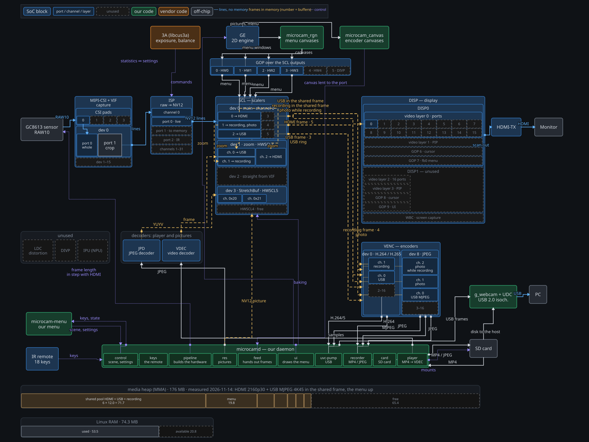

# OpenMicroCam architecture — microcamd on the YIZHAN 4K microscope camera

`microcamd` is the daemon of OpenMicroCam, the open firmware for the YIZHAN 4K HDMI/USB microscope camera (SigmaStar
SSC8836 "Mercury6", GalaxyCore GC8613 sensor). It takes the place of the vendor's application: one process owns the
whole media pipeline — sensor, image processor, scalers, display, encoders — and serves HDMI, the USB camera, photos,
recording, playback and the on-screen menu. It runs on the vendor's kernel and its MI media libraries (the stock
firmware's own; how they work: [`firmware/INDEX.md`](firmware/INDEX.md)), and on two kernel modules of ours. The hardware
facts below are the camera's as read and measured on our unit; how to build and install it: [`INSTALL.md`](INSTALL.md).

The hardware map — the SoC's blocks with their ports, channels and layers, our software and the vendor's, and the paths
the frames take:



Its source, [`artifacts/hardware-map.d2`](artifacts/hardware-map.d2), is in English and Russian; it is drawn into an
interactive page with the facts under every block and arrow.

    tools/scheme/scheme.py docs/artifacts/hardware-map.d2 -o hardware-map.html      # --lang ru: in Russian

What the renderer needs and what the page does: [`tools/scheme/README.md`](../tools/scheme/README.md).

## 1. Blocks

```
 camera                                                              laptop / host
 ┌──────────────────────────────────────────────────────────────┐
 │ microcamd (one process)                                      │   USB: UVC camera (MJPEG, H.264, H.265),
 │   pipeline thread ── owns every MI object, reconciles        │        RNDIS network, SD card as a disk
 │   uvc, pump ──────── UVC gadget events, stream to USB        │   HDMI: monitor
 │   ui ─────────────── draws the menu's scene                  │
 │   menu, ctl ──────── control socket (JSON lines)  ◄──────────┼── microcam CLI, tests, the menu program
 │   card, rec, photo ─ SD card, recording, photo writers       │
 │   health, kmsg ───── watchdog, kernel log                    │
 ├──────────────────────────────────────────────────────────────┤
 │ MI user libraries (vendor) → MI kernel modules → mhal.ko     │
 │ microcam_canvas.ko (ours): frame pools the ports write into  │
 │ microcam_sys.ko (ours): kernel exports mi_sys keeps internal │
 │ sensor driver, USB device driver, UVC gadget                 │
 └──────────────────────────────────────────────────────────────┘
```

Rust crates of the workspace:

| crate | role |
|---|---|
| `mi-sys` | raw bindings to the camera's MI user libraries (bindgen), with layout tests |
| `mi` | the only `unsafe` layer: typed ids, `Result`s, explicit create / destroy; the `Hal` trait with the real implementation and a recording one for tests |
| `microcam-core` | the domain without I/O: sensor modes, USB formats, the policy (inputs → desired state), the reconciler (current + desired → transition), memory prices, EDID, UVC negotiation, the scene, the control protocol |
| `microcam-draw` | the menu's drawing: scene tree to tiles, layers, NV12 helpers |
| `microcamd` | the daemon: the threads above, the UVC gadget adapter, config, logging |
| `microcam-cli` | `microcam`, a client of the control socket (`status`, modes, outputs, log, …) |

`camera/` holds what is installed beside the binaries (`app-start.sh`, `config.toml`, `policy.toml`); `kmods/` our kernel
modules.

## 2. The pipeline model: desired state, reconciled

The pipeline thread is the only one that creates or destroys MI objects. It keeps `Current` (what is built) and receives
a new `Desired`; the reconciler computes the cheapest transition and runs it step by step through the `Hal`. Inputs —
the monitor's EDID, the USB host's stream request, the menu's wishes, preferences — are reduced to `Desired` on that
thread only, so they coalesce in one place; a stream stop followed by a start is a new stream session, never merged
away. Transitions go up a ladder of cost: frame rate only; USB size or codec only; HDMI timing only; a sensor mode change
on the running chain; a full rebuild in the canonical order (consumers first, ports disabled before anything is
destroyed). Teardown is explicit and fallible — `Drop` never touches hardware; a failed step rolls back to the last
built state and the daemon reports a named degraded state instead of continuing silently.

The policy is pure and tested on the laptop: every configuration gets the hardware's maximum; HDMI defaults to the
monitor's largest resolution at its highest rate among the timings the camera can drive; when HDMI and USB compete, the
output the policy names keeps its mode and the other adapts; the host's requested frame rate really applies. What the
hardware can carry is not a formula but the measured mode table (`camera/policy.toml`): only sensor modes measured clean
for that monitor class and USB size are chosen.

## 3. Data paths

```
 sensor ─► VIF ─► ISP ─► SCL dev 0 ─┬─ port 0 ─► canvas pool ─┬─► DISP ─► HDMI-TX ─► monitor
 (GC8613, MIPI 4 lanes)             │                         ├─► JPEG / H.26x encoder (USB, when its frame is HDMI's)
                                    │                         └─► recording / photo encoder
                                    ├─ port 2 ─► canvas pool ─► USB encoder ─► UVC gadget ─► host
                                    │            (H.26x: a one-frame ring straight into the encoder when nothing is drawn)
                                    └─ SCL dev 1 ─► upscaled or zoomed frames, only while needed
 SD card ─► JPEG decoder (JPD) ─► NV12 pictures in the media heap ─┐
 MP4 file ─► video decoder (VDEC) ─► frames ───────────────────────┼─► composed into the output's frame
 menu scene ─► 2D engine (GE) ─► ARGB4444 layer per output (RGN) ──┘   (the overlay hardware lays it over the video)
```

- **Frames go into pools of ours.** Each output frame is a pool of canvases in the media heap, allocated by
  `microcam_canvas.ko`; the scaler port writes into it and every reader — DISP, an encoder, the photo — is handed the
  canvases its own rate takes, by their capture times, once written. One pool serves every output that shows the same
  picture (same size, crop and menu level) whatever its rate, so HDMI and USB at the same size share one pool. Encoders are fed by microcamd, never bound, so a picture appearing or
  going never rebuilds an encoder.
- **Pictures are NV12.** Photos on the card are decoded once by the hardware JPEG decoder at the size the largest window
  needs and shared by every output; the video player feeds VDEC frames the same way. A paused output keeps its last frame.
- **The menu is a scene.** A menu program (any client of the control socket; `tools/ui/` holds a demo) describes a
  retained scene tree on a virtual screen — groups, paths, text laid out by microcamd, images, the live picture. microcamd
  draws it with the 2D engine into one overlay layer per output at that output's size, updated at the frame boundary
  with no added video delay; over a frozen or picture frame the menu is baked into the frame instead.
- **Memory has prices.** microcamd prices every configuration from the same code that would build it (pools, rings,
  codec memory, layers, the transition's peak) and refuses a transition that does not fit; the menu program asks what a
  change would cost and decides what gives way.
- **Latency.** With HDMI showing the live picture, the sensor's frame length is trimmed every few seconds so frames reach
  DISP just before its pass after a vsync, and DISP is handed the canvas the port is about to write; USB's H.26x frame
  goes through a one-frame ring, so the stream leaves about 1 ms after the frame's last row instead of about 29 ms (4K30,
  measured on our unit).

## 4. Control plane

JSON lines over a Unix socket and over TCP on the USB network. Requests name a command and its arguments; replies carry
`ok` / `error` and data; events (output presented, card state, memory account) are pushed to subscribers. The `microcam`
CLI, the tests and the menu program all use it.

## 5. Install and boot

Everything lives in `/customer/microcam/` on the camera. The stock boot script sources `app-start.sh` in place of the
line that started the vendor application; it hides the boot logo, takes the SD card's hot-plug hook away from the vendor
script, loads our UVC gadget and starts `microcamd`. A trial flag is consumed at every boot and a permanent flag marks a
confirmed install, so a microcamd that never confirms itself is followed by a stock boot — the camera always comes up.
microcamd owns the SD card: it mounts it, and on command hands the whole card to the USB host as a removable disk and
takes it back.

## 6. What stays the vendor's

The kernel, the MI libraries and modules, `mhal.ko`, the ISP and codec firmware and the IQ tuning file are taken from the
user's own camera (they are not distributed here); [`firmware/blobs.md`](firmware/blobs.md) maps each and whether
OpenMicroCam uses it, [`tools/install/stock-parts.tsv`](../tools/install/stock-parts.tsv) holds their checksums.
