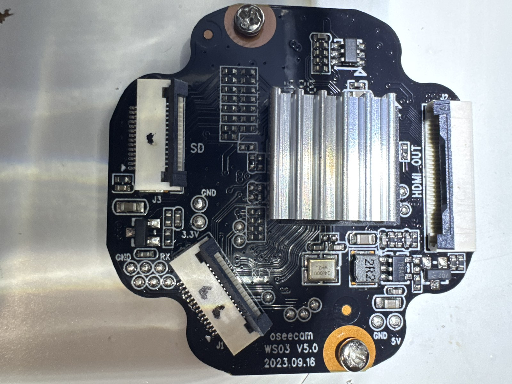
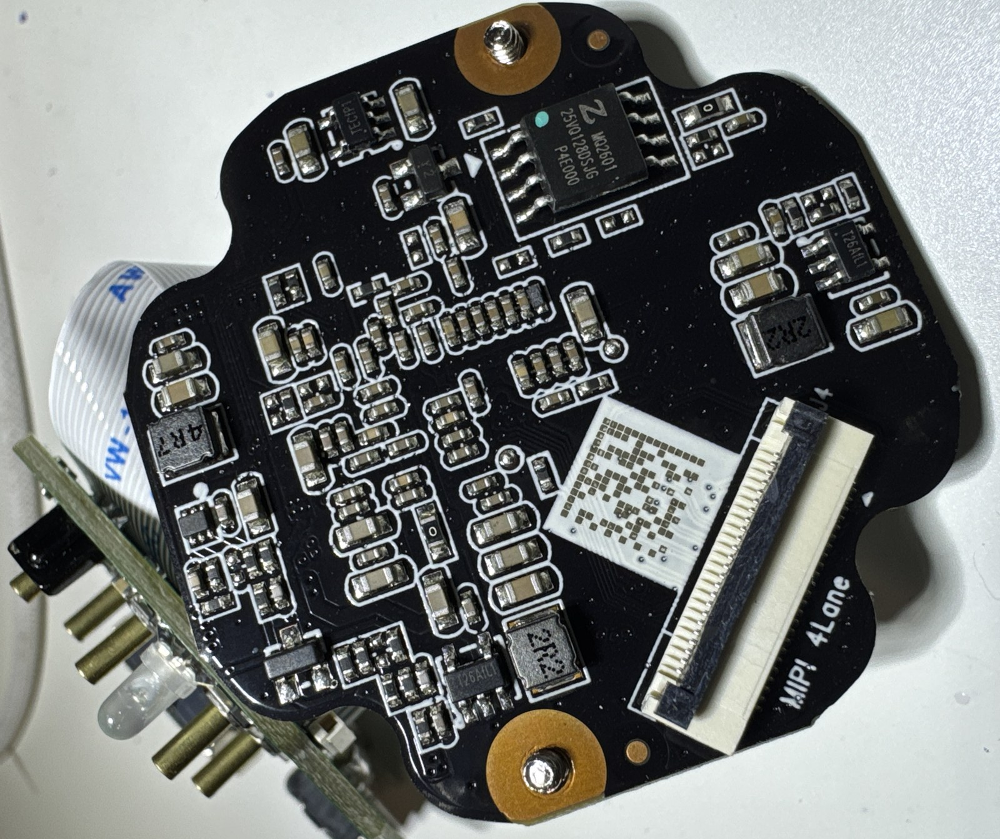

# Supported hardware — the YIZHAN 4K HDMI/USB microscope camera

OpenMicroCam is developed and tested on one camera: the **YIZHAN 4K** HDMI/USB microscope camera, built on the SigmaStar
SSC8836 ("Mercury6") SoC with a GalaxyCore GC8613 image sensor. Every other camera on this platform is at best a
candidate: none is tested, and the same firmware is not proven to run on any other label.

## The tested camera

| mark | value |
|---|---|
| product | sold as «YIZHAN 4K 60MP UHD … HDMI Type-C» digital microscope camera, model **XHU4012** in the listing; the housing reads «YIZHAN 4K ULTRA HD» |
| main board | silkscreen **«oseecam WS03 V5.0 2023.09.16»**; HDMI, SD card and sensor on flat cables (sensor FPC «MIPI 4Lane»); 24 MHz crystal |
| SoC | SigmaStar **SSC8836** (Mercury6, SDK "Tiramisu"), device-tree model `MERCURY6 SSC019A-S01A-S`; 2 × Cortex-A53; 256 MB DRAM. The package marking under the heatsink is not read |
| sensor | GalaxyCore **GC8613**, variant YN (register 0x03f2 = 0x03; chip id 0x03f0 / 0x03f1 = 0x86 / 0x13), I2C bus 1, 7-bit address 0x10. Sellers' listings call it «IMX415» or «IMX415L»; the camera does not carry that Sony part, and the listing's 60 MP is not the sensor's resolution (8 MP, 3840 × 2160). How to tell from a listing: it says «IMX415» or «IMX415L» together with a 1/2.7" sensor size — this camera's listing does [R listing, 2026-11-12] — while Sony's IMX415 is a 1/2.8" part and the GC8613 a 1/2.7" one [S Sony's product flyer; lens and camera datasheets naming the GC8613] |
| flash | 16 MiB SPI NOR, Zbit ZB25VQ128 |
| power | over USB-C, the same port as the data [S owner, 2026-11-12] |
| serial console | a 7-pad group near the J1 connector (RX / GND / 3.3 V; TX on the middle pad), 115200 8N1; the fallback way in ([SHELL-ACCESS.md](SHELL-ACCESS.md)) |
| USB identity, stock | composite device `0ac8:3420`, strings «Linux Foundation» / «Webcam gadget», interface «4K Camera»; UVC camera plus an RNDIS network (camera at 192.168.1.100, a shell over telnet, stock login `root` / `ws123321` [S a public video of this camera; R its hash in the dump's `/etc/shadow`]); with a microSD card in, the stock firmware does not come up on USB as either |

The main board, front: the silkscreen «oseecam WS03 V5.0 2023.09.16», the SigmaStar SSC8836 under the heatsink, the HDMI OUT
and SD connectors, the 24 MHz crystal, the serial console pads by J1.

The back: the 16 MB SPI NOR flash Zbit ZB25VQ128 that holds the firmware, the «MIPI 4Lane» connector of the GC8613 sensor's
flat cable.

More photos of the camera inside: [`images/inside/`](images/inside/).

The stock firmware it was tested with:

| part | build |
|---|---|
| IPL | `MVX4##m6##ga0090c8IPL_###########XVM` |
| U-Boot | 2015.01 «M6», built 2025-06-03 |
| kernel | Linux 4.9.227 `#44 SMP PREEMPT Thu Mar 5 18:01:23 CST 2026`, gcc 9.1.0; release tag `MVX4##M6##gc8e0e527dKL_LX409##[BR:WS_H1605_NOR_8836_IMX662]` |
| MI media stack | `project_commit.7251436 sdk_commit.80327e1 build_time.20220721` |
| stock sensor driver | `MVX3M6__g2029d13af-dirty`, tree `Tiramisu_DLS00V012_8836_UVC`, built 2025-09-20 |
| application version | `/customer/version.txt` = `W11861322604301` |
| NOR image | 16 MiB; its sha256 and every part's: [`stock-parts.tsv`](../tools/install/stock-parts.tsv) |

OpenMicroCam builds against these exact vendor parts: the MI libraries and modules of that build, a kernel with that
module ABI, the GC8613 sensor. [`tools/install/stock-parts.tsv`](../tools/install/stock-parts.tsv) lists every vendor file
and flash region with its checksum, [`firmware/blobs.md`](firmware/blobs.md) what each is; a camera whose files differ is a
different firmware build.

What of the installation ([INSTALL.md](INSTALL.md)) has been tried on this camera:

| step | tried |
|---|---|
| unpack the dump, check it (`unpack-dump.py`, `checkparts.py`) | yes: 227 of 227 files equal to the earlier unpack, 186 of 186 parts same |
| `checkparts.py --camera` | yes |
| `prepare-ktree.sh` | yes: four modules built on it equal in code and data to the ones the camera runs |
| `install.py install` again over the network | yes, on a camera already running OpenMicroCam: check, files (nothing written where the files were the installed ones), flags, bootargs; `demo` refused that camera's development boot script, as it should |
| the stock `demo.sh` with the boot hook, one boot | yes: our modules, `microcamd`; `cam check smoke` passes |
| `MICROCAM-STOCK` with the boot hook, one boot | yes: only the vendor's modules and application loaded; the vendor's menu application was not running and the computer saw no USB device in 3 minutes — with the card in, the stock firmware does not come up on USB |
| `install.py uninstall -n` | yes |
| `install.py dump` over the network | yes, on a camera running OpenMicroCam: the six partitions in 28 s, the camera's second read the same; every region but U-Boot's environment and `/customer` byte-equal to the camera's earlier full dump |
| `install.py uninstall` | yes: the camera back on the stock firmware; with `restore-region.sh customer` after it the whole flash read byte-equal to its first dump |
| on the stock camera, from a fresh clone on a computer set up by [INSTALL.md](INSTALL.md) alone: `install.py dump`, the build, a first `install` | yes: the dump in 9 s over the vendor's USB driver, the stock login taken; the build from an empty toolchain in under 6 minutes; the install in 31 s, `microcamd` running after the reboot |
| over the serial console: `install.py dump --serial`, `restore-region.sh` | yes: the full 16 MB in 17 s, CRC32 and sha256 equal to the first dump; `customer` erased, written and read back in 38 s |
| with a microSD card in, the stock firmware on USB | a storage gadget only (`0525:a4a5`), no camera and no network |
| over the serial console: `install.py access` | not yet |

## The IMX678 camera — tested in this fork

The black YIZHAN 4K with a Sony IMX678 (1/1.8") and 128 MiB SPI NAND; board marked «oseecam WS03 V5.0 2023.09.16», as
above. Its stock firmware (app `do_weishen`, `W1167822507261`) is the one this page lists for the Yizhan XHU4006 below.
It runs OpenMicroCam with its own sensor driver and an SD-card install: [IMX678.md](IMX678.md). Tested over USB (MJPEG):
4K48, 2560×1440@48, 1920×1080@60, 2688×1512@60. Not tested: HDMI, photos, recording, the menu.

## Candidates — not tested

Cameras that share the platform or the maker. None is tested; listed so owners know where to look, not as supported.

| camera | what it shares | what differs or is unknown |
|---|---|---|
| OSEECAM H1605 / H1605-C (the board maker's own 4K HDMI + USB camera) | the kernel's release tag names `WS_H1605`; the same USB resolution list | the H1605-C page names a Sony sensor |
| Yizhan XHU4006 | the same vendor application and MI SDK build, the same «Mercury6» machine | IMX678 sensor, SPI NAND flash; its firmware is the IMX678 camera's above, whose board has the same marking as the tested one |
| PHONEFIX «4K-C1» and other listings with the same specification text (42 × 42 × 46 mm, 1/2.7", 4K30 HDMI) | the listing text and the housing | board not seen |

What a camera with another label but the same board would most likely differ in: the sensor (another driver and IQ file),
the flash type and layout (NAND boards use another loader), the MI build (struct sizes and ids change) and the kernel
build (our modules would not load). `tools/install/checkparts.py` on a dump of it tells which.
