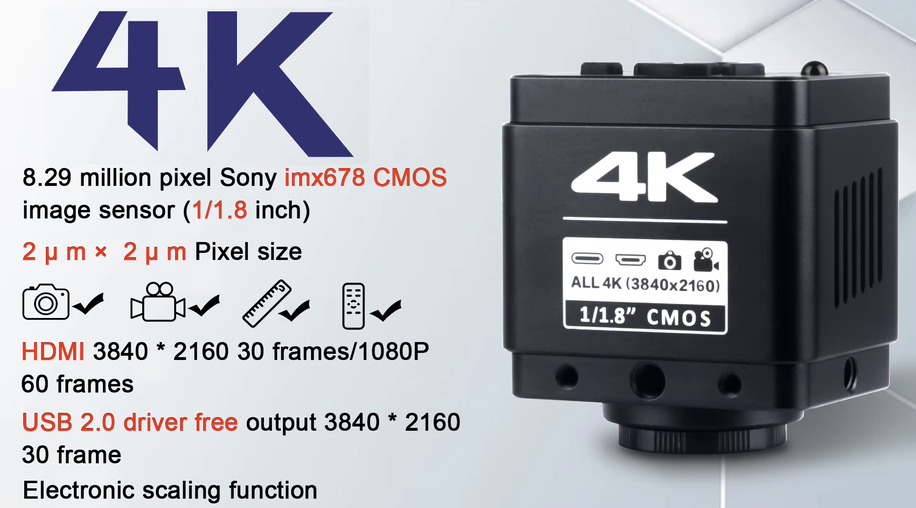

# OpenMicroCam on the IMX678 camera (black YIZHAN 4K)

This fork adds a second camera to OpenMicroCam: a black YIZHAN 4K microscope camera with a **Sony IMX678** sensor and
**SPI NAND** flash. It has the same board as the GC8613 camera the original project is made for, but a different sensor,
flash and stock firmware, so that project's sensor driver and installer don't fit it. What is here: a sensor driver for
the IMX678 with modes the SoC can carry, a few changes to `microcamd`, and an installer that runs from a microSD card.



## The camera

| | |
|---|---|
| Housing | black, front «4K», label «ALL 4K (3840x2160)» and «1/1.8" CMOS» |
| Board | marked «oseecam WS03 V5.0 2023.09.16», the same as the GC8613 camera |
| SoC | SigmaStar SSC8836 (Mercury6) |
| Sensor | Sony IMX678, 1/1.8", 8.29 MP, 2 µm pixels; MIPI 4 lanes |
| Flash | 128 MiB SPI NAND; `/config` and `/customer` are UBIFS volumes |
| Stock firmware | app `do_weishen`, version `W1167822507261` (`/customer/version.txt`); the same firmware as the YIZHAN XHU4006 |
| USB | 2.0 only (the SoC has no USB 3 device controller) |

The install checks the files it changes against this firmware's checksums and changes nothing when they differ.

## How it differs from the stock firmware

The stock firmware's sensor driver has 1080p60, 4K30 and 4K45 modes, but the app only ever uses 4K30. Every output is
30 real frames a second, including the 1080p60 it advertises.

| USB (MJPEG) | stock | here | how |
|---|---|---|---|
| 3840×2160 | 30 | **48** | full sensor |
| 2560×1440 | 30 | **48** | full view, scaled from 4K |
| 1920×1080 | 30 (sent as 60) | **60** | full view, 2×2 binned in the sensor |
| 2688×1512 | — | **60** | a 1:1 centre crop (1.43× narrower view) |
| 1280×720, 640×480, 424×240 | 30 | 60 | from the binned 1080p |

- **The ceiling is the ISP**, at about one pixel per clock while a line comes in: about 432 Mpx/s at its stock 432 MHz.
  The vendor's own 4K45 table (434 Mpx/s) overflows it on every frame, which is why the app never uses it. 4K48 uses a
  slightly longer line (421 Mpx/s). The ISP clock can be raised to 480 MHz, but 4K52/54 then still overflowed and the
  picture shook, so everything runs at the stock clock. The chip runs at about 70 °C streaming 4K with the stock heatsink.
- **Exposure keeps the frame rate:** the auto-exposure is limited to what the frame allows, in whole 10-ms steps
  (anti-flicker for 50 Hz mains light), so the rate never drops in dim light. The picture is darker than the stock 30 fps
  one in dim scenes instead.
- **1080p120 is only possible as a crop.** The binned 1080p reads every sensor row like 4K does, so 60 is the top for a
  full view. A 1920×1080 1:1 crop (2× narrower view) could run at 120; it isn't built.
- **What the computer shows:** USB 2.0 limits MJPEG to about 24 MB/s, and a very detailed 4K scene can fall below 48.
  Some viewers also decode slower than the camera sends (ToupTek ImageView showed about 48 of 60 at 2K). ffmpeg and OBS
  show the full rate.
- Not tested on this camera yet: HDMI, photos, recording and the on-screen menu.

## What is in this fork

- `kmods/imx678/`: the IMX678 driver (`drv_ms_cus_imx678_MIPI.ko`), in place of the vendor's `imx678_MIPI.ko`. It is
  built on OpenMicroCam's GC8613 driver; the IMX678's register tables are the vendor driver's (`tables/vendor.txt`),
  with modes made from them in `modes.py`. Register names are from the sensor's public Linux driver.
- `microcamd` changes: the frame rate via `MI_SNR_SetFps` for a sensor driver without `fps_live`; the sensor driver's live
  parameters found under whichever sensor module is loaded; USB policy rows that can name one USB entry
  (`frame = [format, frame]`); the AE's exposure limit following the frame rate.
- `camera/imx678/`: what goes on the camera: `hook.sh`, `start.sh`, `omc.conf`, microcamd's `config.toml`, `policy.toml`
  and `formats.toml`, the card's `install.sh`, and `patches/` (byte patches the install applies to the camera's own files).
- `tools/imx678/`: `mkcard.py` builds the install card; `linklibs.sh` makes the link libraries; `win-camnet.ps1` sets up
  the USB network on Windows.

## How it is installed

The camera is not opened and nothing of its boot chain is written. The install is a one-time boot from a microSD card:

1. With a card holding `H161X.bin` and an `sd_version.txt` whose version differs from the camera's, the vendor's own
   updater sets the U-Boot variable `ota_upgrade_status` and reboots.
2. The boot loader then starts U-Boot (on a normal boot it skips it), which runs the card's `H161X.bin` as a script. The
   script makes the card inert, sets the variable back to 0, and boots Linux once with a shell that runs `OMC/install.sh`
   from the card.
3. `install.sh` checks the camera's files and makes the patched copies from them in `/customer/omc`:
   - `g_webcam.ko`: the USB gadget with the list above.
   - `libmain_uvc.so`: the vendor app's USB plugin with the USB network on.

   It then copies `microcamd` into `/customer/omc/mcd`, adds one line to `/customer/set.sh`, writes `OMC/install.log` to the
   card and reboots.

> **Tested so far:** steps 1 and 2 are the path used to install on the tested camera, and the patched copies were made
> on the camera, byte-exact. The card as `mkcard.py` builds it has not yet been run end to end. `install.sh` stops
> without changing anything when a file is not the one it expects. A failed install leaves the camera on the vendor app.

From then on the hook runs at every boot, just before the vendor app would start. With `OMC_MICROCAMD=1` it bind-mounts
`start.sh` over the vendor app, and `start.sh` starts microcamd instead. The vendor's files stay as they are on the flash.

### Settings (`/customer/omc/omc.conf`)

| | |
|---|---|
| `OMC_MICROCAMD` | `1` microcamd at every boot; `try` the next boot only; `0` the vendor app |
| `OMC_RNDIS` | `1` USB network: the camera at 192.168.1.100, telnet (`root` / `ws123321`, the stock login) |

- **Fallback:** three boots in a row in which microcamd doesn't run for a minute, or three quick exits in one boot,
  set `OMC_MICROCAMD` to 0 and reboot to the vendor app.
- **The vendor app for one boot:** an empty file named `OMC-STOCK` in the card's root.
- **Removing it for good:** delete the hook's line from `/customer/set.sh` (the original is `/customer/omc/set.sh.orig`)
  and `/customer/omc`.

### The USB network

The camera's USB driver drops network frames larger than one USB packet, so **the computer's MTU must be 400**.

- **Windows:** in Device Manager, install «Remote NDIS Compatible Device» (Microsoft) on the camera's RNDIS function by
  hand. Then run `tools/imx678/win-camnet.ps1` in an administrator PowerShell.
- **Linux:** `ip addr add 192.168.1.2/24 dev <if>` and `ip link set <if> mtu 400 up`.

## Building

This fork is based on OpenMicroCam 0.9 (commit `f930030`); that is the version tested on the camera. The changes also
apply cleanly to the later 0.91, but that combination hasn't been tested.

The build follows the original's [INSTALL.md](INSTALL.md) and [TOOLS.md](TOOLS.md) on a Linux computer (WSL works too):
the toolchain, the kernel tree and the build of `microcamd` and the modules. The difference is where the camera's
libraries come from. The original takes them from a dump of the NOR camera, and its checks refuse this camera's firmware
(another SDK build). Here they are copied off the camera itself.

```sh
# 1. a network-only card: the USB network and telnet, the vendor app stays
python3 tools/imx678/mkcard.py /media/$USER/CARD        # or any directory, then copy its files to the card's root
#    card in, power on: the camera reboots twice; take the card out and check OMC/install.log ends in «OK»

# 2. the camera's MI libraries (telnet 192.168.1.100, root / ws123321):
#    camera:   cd /config && tar cf - lib | nc -l -p 5001
#    computer: nc 192.168.1.100 5001 > camera-lib.tar && mkdir camera-lib && tar xf camera-lib.tar -C camera-lib
tools/imx678/linklibs.sh camera-lib/lib

# 3. build (toolchain and kernel tree: INSTALL.md)
cargo zigbuild --release --target armv7-unknown-linux-gnueabihf.2.30
for m in microcam-sys microcam-canvas imx678; do sh kmods/build-ko.sh kmods/$m; done
cp target/armv7-unknown-linux-gnueabihf/release/microcamd target/armv7-unknown-linux-gnueabihf/release/microcam stage/

# 4. the install card, with microcamd
python3 tools/imx678/mkcard.py /media/$USER/CARD stage
```

## Credits

OpenMicroCam is the work of **[apnix](https://github.com/apnix)**:
[github.com/apnix/openmicrocam](https://github.com/apnix/openmicrocam). Everything that makes this camera work, including
`microcamd`, the kernel modules, the build and the knowledge of the SigmaStar platform, is theirs. This fork adds only the
IMX678 camera.
