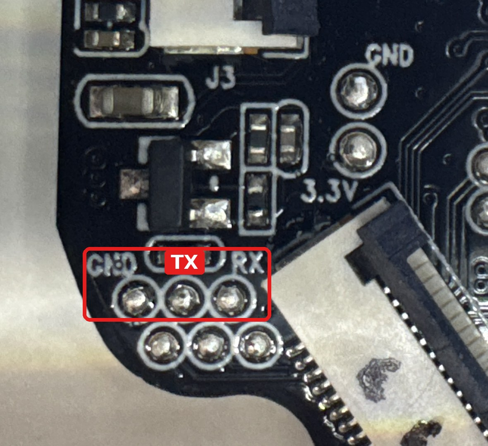

# Root shell on the YIZHAN 4K microscope camera: the fallback ways

The usual way into the YIZHAN 4K HDMI/USB microscope camera (SigmaStar SSC8836 / Mercury6, GC8613 sensor) is telnet over
its own USB network with the stock login ([INSTALL.md](INSTALL.md)). This page is for a camera where that does
not work: it does not come up on USB, or its shell refuses the login. Two ways remain, both over the board's serial
console: log in on the console itself, or boot once into a shell that asks for no password.

## The serial console

The console is a 3.3 V UART on the board's group of seven pads near the J1 connector: RX, GND and 3.3V are marked on the
silkscreen, TX is the unmarked middle pad. 115200 8N1.

- Use a **3.3 V** USB-serial adapter; a 5 V one can damage the SoC. Connect its GND to GND, its RX to the camera's TX and
  its TX to the camera's RX; leave the 3.3V pad unconnected (the camera is powered over USB).
- `python3 tools/cam/uart.py bridge` owns the port and logs everything the camera prints; keep it running in a terminal.
  Other commands talk through it: `uart.py send 'TEXT'` sends a line and prints the answer. Port and speed:
  `MICROCAM_SERIAL`, `MICROCAM_SERIAL_BAUD` ([TOOLS.md](TOOLS.md)).
- The stock firmware runs a login prompt on the console, with the same login as telnet. `uart.py login` logs in with
  `MICROCAM_USER` / `MICROCAM_PASSWORD` — the stock login unless set.

The console also shows the boot itself, U-Boot's and the kernel's messages, which is the first thing to look at when the
camera does not come up on USB.

## A shell without a password: U-Boot `init=/bin/sh`

When the login is unknown or the boot no longer reaches a shell, start the kernel once with a shell as its first
process. Nothing is written to the flash; the next power-up boots as before.

1. With `uart.py bridge` running, `uart.py uboot` asks for a power-cycle and catches the prompt by sending Enter
   continuously — this U-Boot waits no time for a key (`bootdelay=0`).
2. At the `SigmaStar #` prompt, `printenv bootargs` shows the kernel's command line. Set it again with `init=/linuxrc`
   replaced by `init=/bin/sh`, the rest unchanged: `setenv bootargs <the line, edited>`.
3. `run bootcmd`. The kernel boots straight into a root shell on the console. **Do not** run `saveenv`: the change must
   stay in RAM.
4. Nothing is mounted and nothing of the camera's own runs. Mount what the fix needs, e.g.
   `mount -t proc proc /proc; mount -t jffs2 mtd:customer /customer` (the writable partition with the boot script
   `/customer/demo.sh`), make the fix, `sync`, and power-cycle.

`tools/cam/uboot-rescue.sh "<fix command>"` does all of it in one step: it catches the prompt, boots the shell, mounts
`/customer`, runs the command and syncs. To get a known login instead of repairing by hand, `tools/install/install.py
access` takes this way too ([INSTALL.md](INSTALL.md) «Over the serial console (UART)»).
